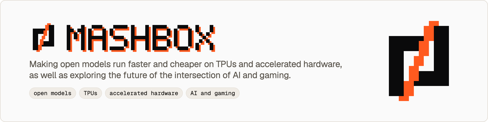

<p align="center">
  <picture>
    <source media="(prefers-color-scheme: dark)" srcset="banner-dark.png">
    
  </picture>
</p>

<h3 align="center">MASHBOX Labs makes open models run faster and cheaper on TPUs and accelerated hardware, as well as exploring the future of the intersection of AI and gaming.</h3>

<p align="center">
  <a href="https://mashbox.gg"><b>mashbox.gg</b></a> •
  <a href="https://github.com/mashbox-labs/mashbox"><b>mashbox</b></a> •
  <a href="https://mashbox.gg/docs"><b>Docs</b></a> •
  <a href="https://mashbox.gg/docs/supported-models"><b>Supported models</b></a> •
  <a href="https://huggingface.co/mashbox-labs"><b>Hugging Face</b></a> •
  <a href="https://github.com/mashbox-labs/mashbox/blob/main/AGENTS.md"><b>For coding agents</b></a> •
  <a href="https://x.com/mashboxgg"><b>X</b></a>
</p>

<p align="center">
  <a href="https://github.com/mashbox-labs/mashbox/blob/main/LICENSE"></a>
  <a href="https://github.com/mashbox-labs/mashbox"></a>
  <a href="https://huggingface.co/mashbox-labs"></a>
</p>

We make open models run faster and cheaper on Google Cloud TPU, and we build AI for games.

### What we do

- **[mashbox](https://github.com/mashbox-labs/mashbox)** is our open-source engine. One install and one command take a model from download to answering on your own TPU, with a server that Claude Code, Codex and Pi can use as their model.
- **Open models, as they are.** mashbox runs GGUF files from the community without converting them. Families covered so far: Qwen, Llama, Gemma, Mistral, Granite, Falcon and EXAONE. Every file, and how far it has been checked, is on [Supported models](https://mashbox.gg/docs/supported-models).
- **Our own builds.** Open models we port and tune with our own TPU kernels. The weights are on [Hugging Face](https://huggingface.co/mashbox-labs), with size, bits per weight and measured numbers on every card.
- **AI and gaming.** 3D creatures from a text prompt, motion for any creature, and [Steer](https://mashbox.gg/steer): watch which neurons fire as a model reads your text, then turn them up or down. More on [mashbox.gg](https://mashbox.gg) and [Research](https://mashbox.gg/research).

### Start

```bash
curl -fsSL https://mashbox.gg/install.sh | sh
```

macOS or Linux; on a Cloud TPU VM the same line installs the TPU version. The [quickstart](https://mashbox.gg/docs/quickstart/) goes from a new Google account to a model answering on your own chip. [AGENTS.md](https://github.com/mashbox-labs/mashbox/blob/main/AGENTS.md) gives a coding agent the same steps.

### Contributing

Bug reports, fixes and model requests are welcome: [CONTRIBUTING.md](https://github.com/mashbox-labs/.github/blob/main/CONTRIBUTING.md). Security reports go through [SECURITY.md](https://github.com/mashbox-labs/.github/blob/main/SECURITY.md).

[mashbox.gg](https://mashbox.gg)&nbsp;&nbsp;&nbsp;[x.com/mashboxgg](https://x.com/mashboxgg)&nbsp;&nbsp;&nbsp;hello@mashbox.gg
